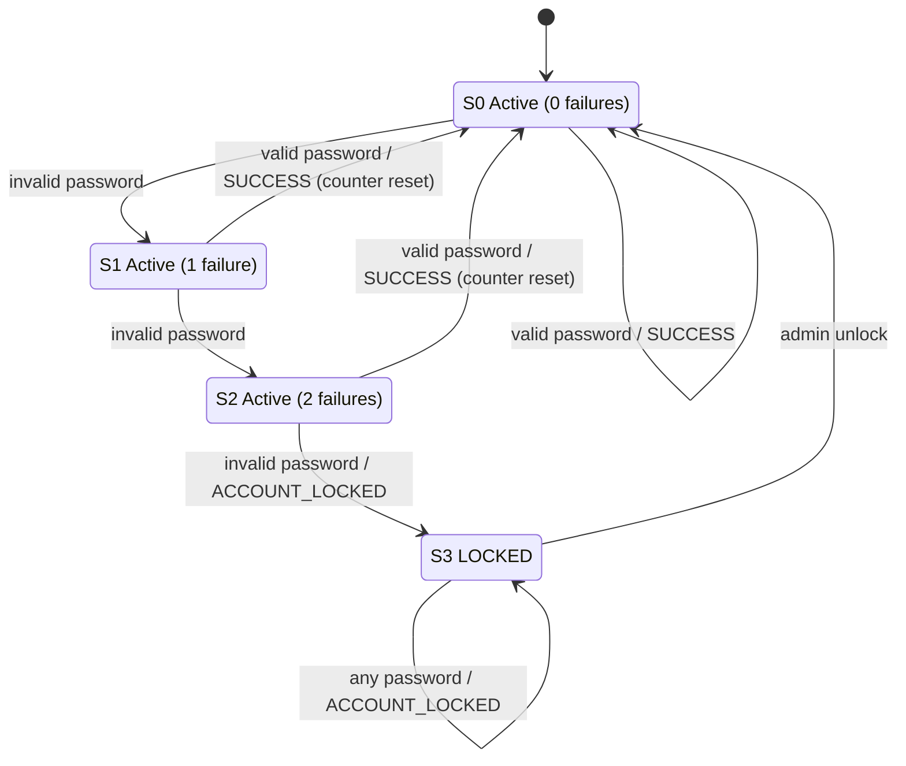
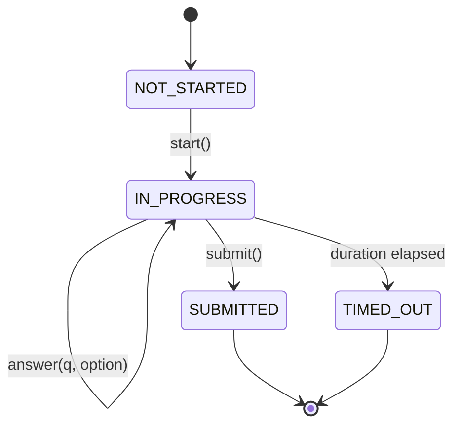

# State Transition Testing

State transition testing is used when the system's response depends on its current state and
the event it receives. We cover every valid transition and the important invalid ones.

---

## 1. Login / Account lock-out (REQ-06 … REQ-09)

### 1.1 State diagram

### 1.2 State table

| Current state \ Event | Valid password | Invalid password | Admin unlock |
|-----------------------|----------------|------------------|--------------|
| **S0** Active (0) | SUCCESS → S0 | INVALID_CREDENTIALS → S1 | — |
| **S1** Active (1) | SUCCESS → **S0** | INVALID_CREDENTIALS → S2 | — |
| **S2** Active (2) | SUCCESS → **S0** | ACCOUNT_LOCKED → S3 | — |
| **S3** Locked | ACCOUNT_LOCKED → S3 | ACCOUNT_LOCKED → S3 | → S0 |

### 1.3 Test cases

| TC ID | Start state | Event sequence | Expected result / end state |
|-------|-------------|----------------|-----------------------------|
| TC_LGN_ST_01 | S0 | valid | SUCCESS, stays S0 |
| TC_LGN_ST_02 | S0 | invalid | INVALID_CREDENTIALS, S1 (failed attempts = 1) |
| TC_LGN_ST_03 | S0 | invalid × 3 | 3rd attempt → ACCOUNT_LOCKED, S3 |
| TC_LGN_ST_04 | S3 | valid | ACCOUNT_LOCKED, stays S3 |
| TC_LGN_ST_05 | S2 | valid | SUCCESS, S0 (failed attempts reset to 0) |
| TC_LGN_ST_06 | S0 | invalid, valid, invalid, invalid | last → INVALID_CREDENTIALS, account **not** locked |
| TC_LGN_ST_07 | S3 | admin unlock, valid | SUCCESS, S0 |
| TC_LGN_ST_08 | — | login with unregistered user | USER_NOT_FOUND |

---

## 2. Exam Session life cycle (REQ-10 … REQ-13)

### 2.1 State diagram

### 2.2 State table (✗ = invalid event, must be rejected with an error)

| State \ Event | start() | answer() | submit() | time elapses |
|---------------|---------|----------|----------|--------------|
| **NOT_STARTED** | → IN_PROGRESS | ✗ | ✗ | — |
| **IN_PROGRESS** | ✗ | → IN_PROGRESS | → SUBMITTED | → TIMED_OUT |
| **SUBMITTED** | ✗ | ✗ | ✗ | — |
| **TIMED_OUT** | ✗ | ✗ | ✗ | — |

### 2.3 Test cases

| TC ID | Start state | Event | Expected result |
|-------|-------------|-------|-----------------|
| TC_EXM_ST_01 | (new session) | — | State = NOT_STARTED |
| TC_EXM_ST_02 | NOT_STARTED | start() | State = IN_PROGRESS |
| TC_EXM_ST_03 | NOT_STARTED | answer() | IllegalStateException |
| TC_EXM_ST_04 | NOT_STARTED | submit() | IllegalStateException |
| TC_EXM_ST_05 | IN_PROGRESS | submit() | State = SUBMITTED |
| TC_EXM_ST_06 | SUBMITTED | answer() | IllegalStateException; saved answers unchanged |
| TC_EXM_ST_07 | IN_PROGRESS | duration (30 min) elapses | State = TIMED_OUT, remaining time = 0 |
| TC_EXM_ST_08 | TIMED_OUT | answer() | IllegalStateException |
| TC_EXM_ST_09 | IN_PROGRESS | start() again | IllegalStateException |
| TC_EXM_ST_10 | TIMED_OUT | submit() | IllegalStateException |
| TC_EXM_ST_11 | IN_PROGRESS | answer() with option index 7 (only 0–3 valid) | IllegalArgumentException |
| TC_EXM_ST_12 | IN_PROGRESS | answer Q1 = 0, then Q1 = 2 | Saved answer for Q1 = 2 |
