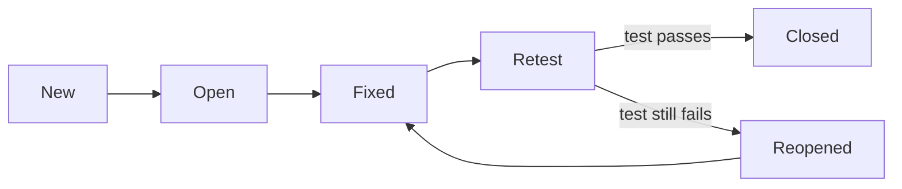

# Defect Log — Online Examination System

## Defect life cycle followed

## Defect summary

| Defect ID | Title | Module | Found by (TC) | Technique | Severity | Priority | Status |
|-----------|-------|--------|---------------|-----------|----------|----------|--------|
| [DEF-001](DEF-001_Age_Upper_Boundary.md) | Student aged exactly 60 cannot register | Registration | TC_REG_BVA_05 | BVA | Medium | High | Closed |
| [DEF-002](DEF-002_Login_Counter_Not_Reset.md) | Failed-login counter not reset after successful login | Login | TC_LGN_ST_05, 06 | State Transition | High | High | Closed |
| [DEF-003](DEF-003_Answer_After_Submit.md) | Answers can be changed after exam submission | Exam Session | TC_EXM_ST_06 | State Transition | Critical | High | Closed |
| [DEF-004](DEF-004_Grade_Boundary_75.md) | 75 % graded B instead of A | Grading | TC_GRD_BVA_08 | BVA | High | High | Closed |
| [DEF-005](DEF-005_Malpractice_Result_Status.md) | Malpractice below 40 % shows FAIL instead of WITHHELD | Result | TC_RES_DT_07, 08 | Decision Table | High | Medium | Closed |

## Defect distribution

| By severity | Count | | By technique that found it | Count |
|-------------|:-----:|-|----------------------------|:-----:|
| Critical | 1 | | Boundary Value Analysis | 2 |
| High | 3 | | State Transition | 2 |
| Medium | 1 | | Decision Table | 1 |
| Low | 0 | | Equivalence Partitioning | 0 |
| **Total** | **5** | | **Total** | **5** |
