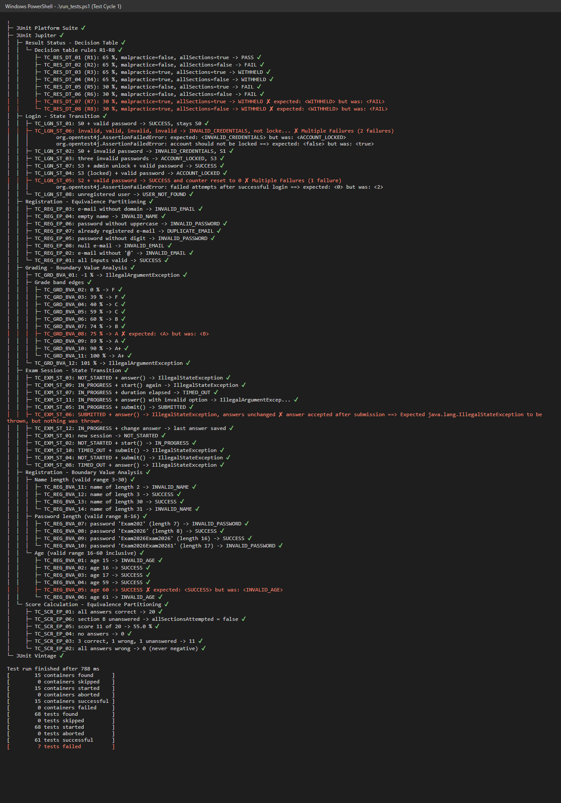
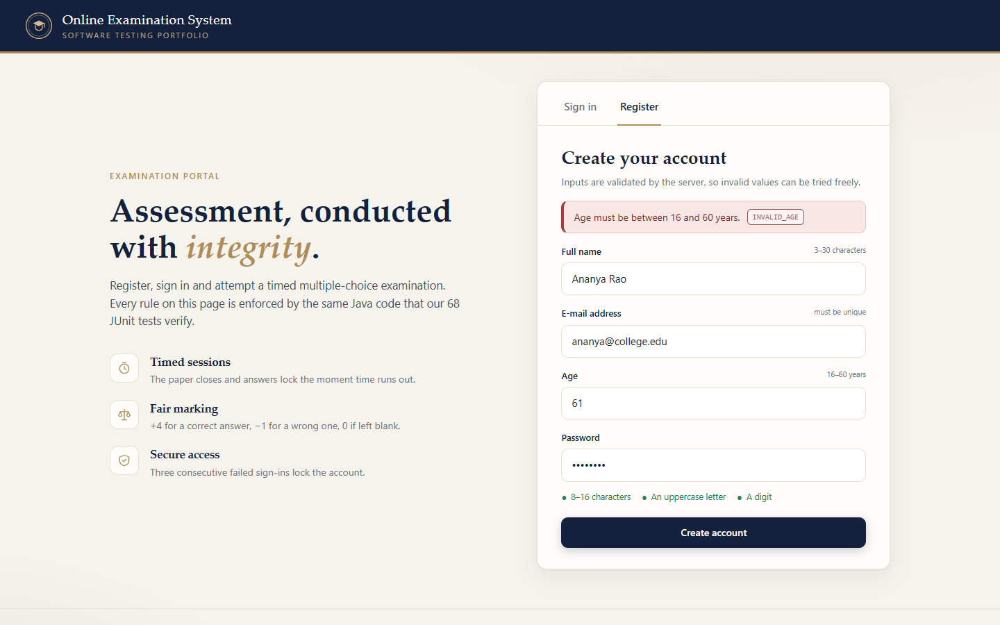
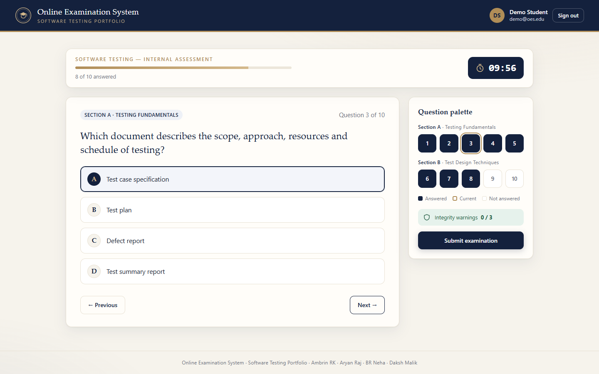

# 07 — Screenshots

| # | Screenshot | What it shows |
|---|------------|---------------|
| 1 | [01_Cycle1_JUnit_Console.png](01_Cycle1_JUnit_Console.png) | JUnit 5 console run in Cycle 1: 68 tests, 7 failures (in red) |
| 2 | [02_Cycle1_HTML_Report.png](02_Cycle1_HTML_Report.png) | Cycle 1 HTML report: expected vs. actual for every test case, pass rate 89.7 % |
| 3 | [03_Cycle2_HTML_Report.png](03_Cycle2_HTML_Report.png) | Cycle 2 HTML report after the defect fixes: 68/68 passed |
| 4 | [04_Cycle2_JUnit_Console.png](04_Cycle2_JUnit_Console.png) | JUnit 5 console run in Cycle 2 (retest + regression), all green |
| 5 | [05_Demo_Application_Run.png](05_Demo_Application_Run.png) | Console demo of the Online Examination System (register → login → exam → result) |
| 6 | [06_Web_SignIn.png](06_Web_SignIn.png) | Web UI: sign-in page |
| 7 | [07_Web_Register_Validation.png](07_Web_Register_Validation.png) | Web UI: registering with age 61 is rejected with `INVALID_AGE` (BVA upper boundary + 1) |
| 8 | [08_Web_Dashboard.png](08_Web_Dashboard.png) | Web UI: candidate dashboard with exam details and rules |
| 9 | [09_Web_Exam.png](09_Web_Exam.png) | Web UI: timed exam with question palette and integrity warnings |
| 10 | [10_Web_Result.png](10_Web_Result.png) | Web UI: result statement showing score 22/40, grade C, PASS, how the decision table decided it, and an answer review |

## Cycle 1: defects detected

## Cycle 2: all tests pass after the fixes

## Application demo

## Web front end

