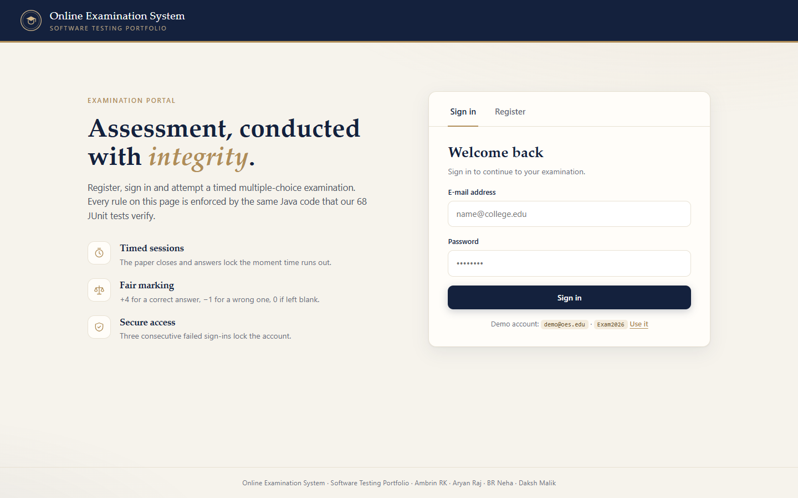
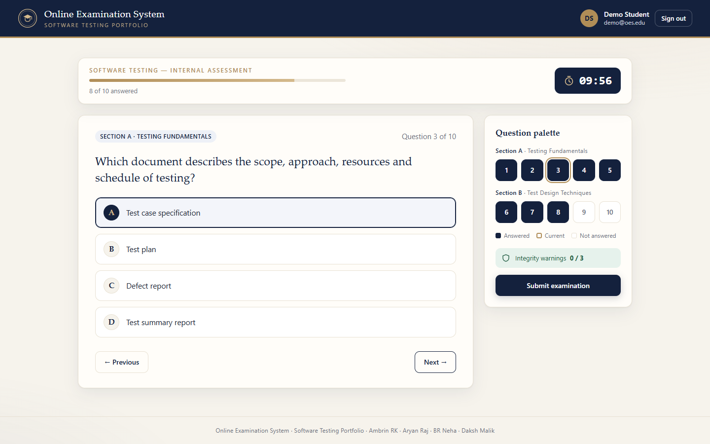
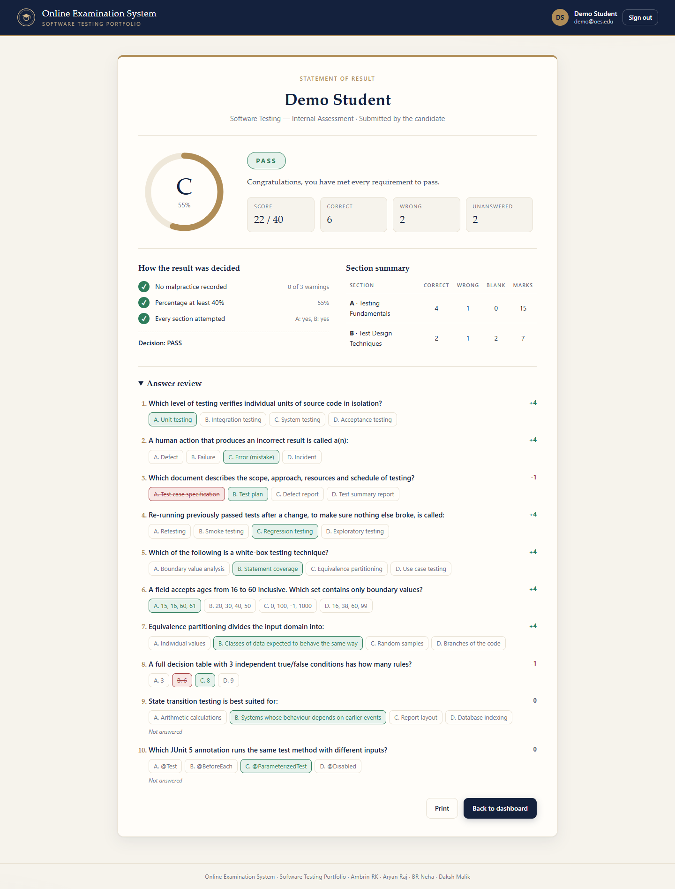
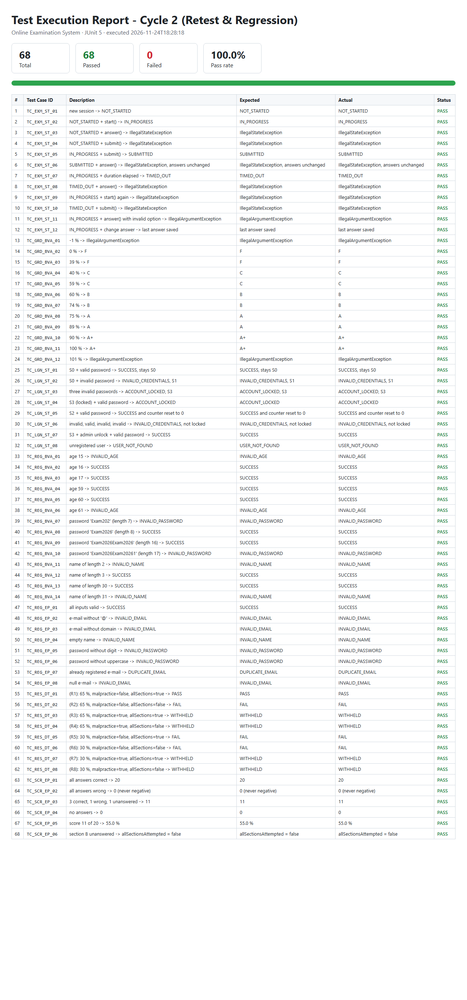

# Software Testing Portfolio — Online Examination System

> A GitHub-based portfolio documenting the complete software testing life cycle
> (planning → design → execution → defect management → automation → reporting)
> carried out on an **Online Examination System (OES)**.

---

## 1. Student / Team Details

| # | Name | USN | Role in Team |
|---|------|-----|--------------|
| 1 | Ambrin RK | 1MS23IS011 | Test Lead / Automation |
| 2 | Aryan Raj | 1MS23IS022 | Test Designer |
| 3 | BR Neha | 1MS23IS025 | Test Executor |
| 4 | Daksh Malik | 1MS23IS036 | Defect & Report Manager |

| Field | Details |
|-------|---------|
| **Subject** | Software Testing |
| **Course / Semester** | B.E. Information Science and Engineering — Semester 7 |
| **Institution** | Ramaiah Institute of Technology |
| **Faculty In-charge** | Kavya Kasetty |
| **Component** | Online Portfolio using GitHub Activity (20 marks) |

---

## 2. Objectives

1. Understand an application's requirements and identify the modules and functionalities to be tested.
2. Prepare a structured **test plan** (scope, approach, resources, schedule, entry/exit criteria, risks).
3. Design test cases using black-box techniques — **Equivalence Partitioning, Boundary Value Analysis,
   Decision Tables and State Transition testing**.
4. **Execute** the test cases, record actual results and compare them with expected results.
5. **Identify, document and track defects** through their life cycle (New → Fixed → Retested → Closed).
6. **Automate** the test cases using **JUnit 5**.
7. Prepare a **test execution summary report** and maintain the work in GitHub with meaningful commits.

---

## 3. Project Description

### 3.1 Application under test — Online Examination System

The Online Examination System lets students register, log in, take a timed multiple-choice exam,
and receive their score, grade and result. A compact Java implementation of the system's core
business logic is included in [`05_Test_Automation/src/main`](05_Test_Automation/src/main/java/com/oes)
so that every test case in this portfolio is **actually executed** against real code.
A **web front end** (register → sign in → timed exam → result) runs on top of the same tested classes.

### 3.2 Run the web application

> **Note:** the app runs on your own computer. The link below works only **after** you start the
> server with the command in step 1; it is not a public website.

1. Open a terminal (PowerShell) and start the server. Requires JDK 17 or newer.
   ```powershell
   cd 05_Test_Automation
   .\run_tests.ps1 -Web
   ```
2. Open **http://localhost:9090/** in your browser. It usually opens on its own.
3. Sign in with the demo account **`demo@oes.edu`** / **`Exam2026`**, or register a new student.
4. Press **Ctrl + C** in the terminal to stop the server.

| Option | Command |
|--------|---------|
| 1-minute exam (to show the automatic time-out) | `.\run_tests.ps1 -Web -ExamSeconds 60` |
| Use a different port if 9090 is busy | `.\run_tests.ps1 -Web -Port 9091` |
| Git Bash / Linux / macOS | `./run_tests.sh --web` |

| Sign in | Exam | Result |
|:---:|:---:|:---:|
|  |  |  |

### 3.3 Modules and functionalities tested

| Module | ID | Functionalities tested | Technique(s) applied |
|--------|----|------------------------|----------------------|
| Student Registration | REG | Name, e-mail, age and password validation; duplicate e-mail check | Equivalence Partitioning, BVA |
| Login / Authentication | LGN | Credential check, failed-attempt counter, account lock after 3 failures, admin unlock | State Transition |
| Exam Session | EXM | Start, answer, change answer, submit, auto time-out, invalid operations | State Transition, EP |
| Score Calculation | SCR | +4 per correct answer, −1 negative marking, floor at 0, percentage, section coverage | Equivalence Partitioning |
| Grade & Result | GRD / RES | Percentage → grade bands; PASS / FAIL / WITHHELD decision | BVA, Decision Table |

### 3.4 Tools & technologies

| Purpose | Tool |
|---------|------|
| Language of the application under test | Java 21 |
| Unit / automation testing framework | JUnit 5 (Jupiter 5.11, console launcher) |
| Version control & portfolio hosting | Git + GitHub |
| Web front end | HTML, CSS, JavaScript + Java built-in HTTP server (no extra libraries) |
| Diagrams | Mermaid (rendered natively by GitHub) |
| HTML test report | Python 3 script (`05_Test_Automation/tools/junit_xml_to_html.py`) |

---

## 4. Repository Structure

```
Software-Testing-Portfolio/
├── README.md                     ← you are here
├── 01_Test_Plan/                 ← IEEE-829 style test plan
├── 02_Test_Case_Design/          ← EP, BVA, Decision Table, State Transition + master test case list
├── 03_Test_Execution/            ← execution logs with actual results (Cycle 1 & Cycle 2)
├── 04_Defect_Reports/            ← defect log + individual defect reports
├── 05_Test_Automation/           ← application source, JUnit 5 test suite, run scripts
├── 06_Test_Reports/              ← test execution summary, JUnit XML & HTML reports
├── 07_Screenshots/               ← screenshots of executions and reports
└── Conclusion.md                 ← learnings and conclusion
```

---

## 5. Results at a Glance

| | Cycle 1 | Cycle 2 (retest + regression) |
|---|:---:|:---:|
| Test cases executed | 68 | 68 |
| Passed | 61 | **68** |
| Failed | 7 | **0** |
| Pass rate | 89.7 % | **100 %** |
| Defects found / open | 5 / 5 | 5 / **0** |

| Deliverable | Link |
|-------------|------|
| Test plan | [01_Test_Plan/Test_Plan.md](01_Test_Plan/Test_Plan.md) |
| Test case design (EP, BVA, DT, ST) + RTM | [02_Test_Case_Design](02_Test_Case_Design/README.md) |
| Test execution logs | [Cycle 1](03_Test_Execution/Test_Execution_Log_Cycle1.md) · [Cycle 2](03_Test_Execution/Test_Execution_Log_Cycle2.md) |
| Defect reports | [04_Defect_Reports/Defect_Log.md](04_Defect_Reports/Defect_Log.md) |
| JUnit 5 automation | [05_Test_Automation](05_Test_Automation/README.md) |
| Test execution summary report | [06_Test_Reports/Test_Execution_Summary.md](06_Test_Reports/Test_Execution_Summary.md) |
| Screenshots | [07_Screenshots](07_Screenshots/README.md) |
| Conclusion | [Conclusion.md](Conclusion.md) |



---

## 6. How to Run the Automated Tests

**Prerequisite:** JDK 17 or newer (`javac -version`). No Maven/Gradle needed — the JUnit console
launcher jar is included in `05_Test_Automation/lib`.

```powershell
# Windows (PowerShell)
cd 05_Test_Automation
.\run_tests.ps1
```

```bash
# Linux / macOS / Git Bash
cd 05_Test_Automation
./run_tests.sh
```

To run the application itself:

| Command (PowerShell) | Git Bash equivalent | What it does |
|----------------------|---------------------|--------------|
| `.\run_tests.ps1 -Web` | `./run_tests.sh --web` | Starts the **web UI** at http://localhost:9090/ (demo login `demo@oes.edu` / `Exam2026`) |
| `.\run_tests.ps1 -Web -ExamSeconds 60` | `EXAM_SECONDS=60 ./run_tests.sh --web` | Same, with a 1-minute exam to show the automatic time-out |
| `.\run_tests.ps1 -Demo` | `./run_tests.sh --demo` | Console demo of the full flow |
